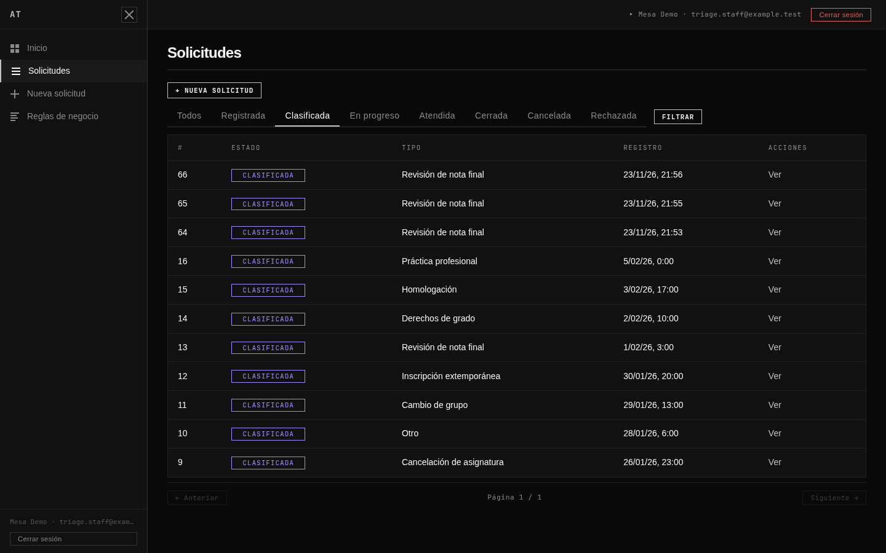
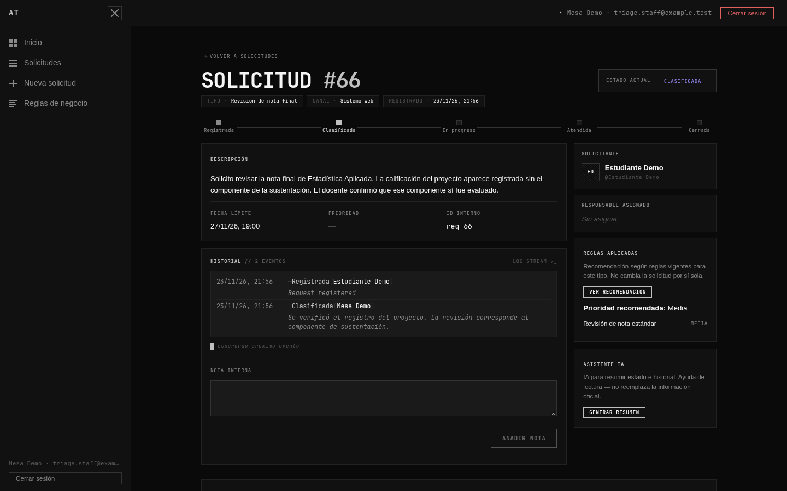
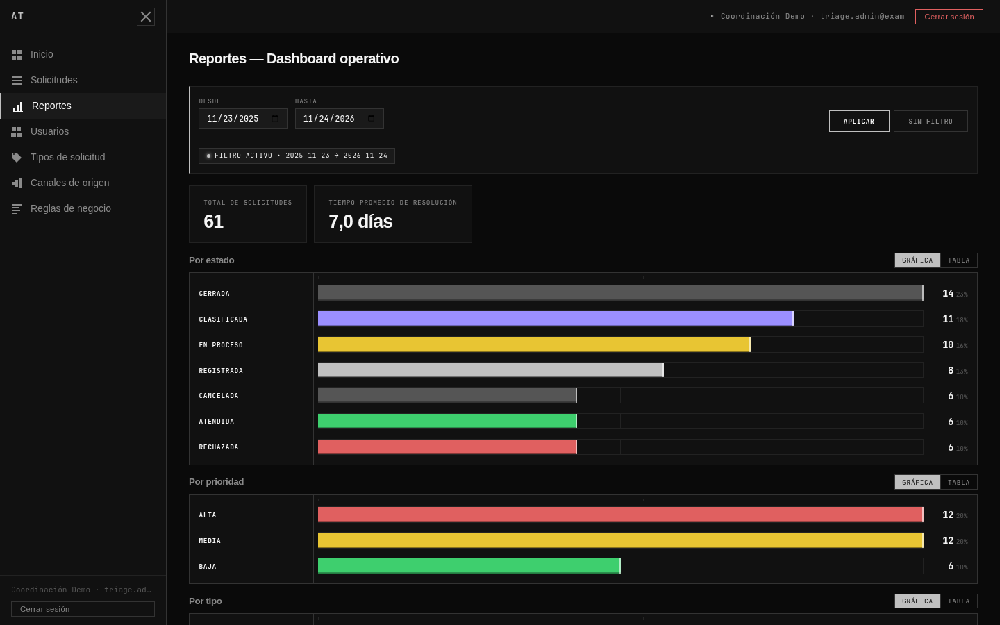
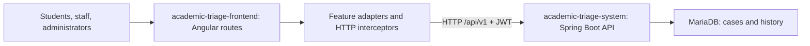

<!-- markdownlint-disable-next-line MD041 -->
<div align="center">

<h1>Academic Triage · Web App</h1>

<p><strong>One place for students and service desk staff to track academic requests at Universidad del Quindío.</strong></p>

<p>
<a href="https://github.com/diegnghtmr/academic-triage-frontend/actions/workflows/ci-cd.yml"></a>


<a href="LICENSE"></a>
</p>

<p>
<a href="https://diegnghtmr.me/en/work/academic-triage/"><strong>Case study</strong></a> &bull;
<a href="#quick-start"><strong>Quick start</strong></a> &bull;
<a href="#architecture"><strong>Architecture</strong></a> &bull;
<a href="https://github.com/diegnghtmr/academic-triage-system"><strong>Backend repo</strong></a>
</p>

</div>

<p align="center"></p>

A grade review and an urgent group change can arrive in the same queue, but they need different follow-up. Academic Triage gives students a way to submit and track cases, staff a queue to classify and assign them, and administrators a view of what is waiting and how long resolution takes. The browser displays actions for the signed-in role and case state; the API decides whether an action is allowed.

## Features

- **Student intake and follow-up.** Register a request and follow its current status and recorded history.
- **Staff triage queue.** Filter and page through cases, then classify, prioritize, assign, attend, close, cancel, or reject as permitted by the backend.
- **Priority recommendations.** Inspect the matching business rules before saving a priority decision.
- **Administration.** Manage request types, intake channels, priority rules, and staff or administrator accounts.
- **Operational reporting.** Review the workload by date, status, priority, or request type, with chart and table views.
- **Optional AI assistance.** Request a suggested classification or case summary; an unavailable provider does not block the workflow.

## Preview



Staff can inspect the recommended priority and its matching rule without modifying the case.



The operational report uses the selected date range; the figures shown come from the local demo dataset.

## Quick start

Use Node.js **22 LTS** (at least 22.12, as pinned in [.nvmrc](.nvmrc) and [package.json](package.json)) and npm 10 or later. Start the [official backend](https://github.com/diegnghtmr/academic-triage-system#quick-start) on port `8080` before signing in; the frontend has no embedded backend.

```sh
git clone https://github.com/diegnghtmr/academic-triage-frontend.git
cd academic-triage-frontend
npm ci
npm run dev
```

Open <http://localhost:4200>. The CLI proxy forwards `/api` to port `8080`; no frontend environment variables are needed. To try all roles locally, use the backend's `dev` dataset and refer to its development migrations for the demo accounts. Do not enable those accounts in shared environments. Swagger UI is at <http://localhost:8080/swagger-ui.html> when enabled on the backend.

| Setting                                                                     | Purpose                                               | Default                                              |
| --------------------------------------------------------------------------- | ----------------------------------------------------- | ---------------------------------------------------- |
| `apiBaseUrl` in [environment.ts](src/environments/environment.ts)           | Development API path.                                 | `/api/v1`                                            |
| `apiBaseUrl` in [environment.prod.ts](src/environments/environment.prod.ts) | API base selected by the production file replacement. | `https://academic-triage-system.onrender.com/api/v1` |
| [proxy.conf.json](proxy.conf.json)                                          | Angular CLI development proxy target.                 | `http://localhost:8080`                              |

`npm run start` is an alias for `npm run dev`. `npm run build` writes the production bundle to `dist/`. If the browser calls the API across origins (rather than via the proxy), the backend must allow the frontend origin.

## Architecture

Standalone, lazily loaded features map API DTOs to view models in per-feature adapters. The `API_BASE_URL` token and functional interceptors handle the base URL, bearer token, request key, and unauthorized responses. The session token and user are persisted in browser storage; request data stays on the server. `ADMIN`, `STAFF`, and `STUDENT` guards control screen access, not API permission. A `401` clears the session and redirects to sign-in with a safe return path; features opt in to `application/problem+json` mapping.



### Idempotency and concurrency contract

The interceptor attaches an `Idempotency-Key` to mutations and keeps a caller-supplied key; reuse that key for retries of the same operation. Administrative writes that require `If-Match` still need the resource's `ETag`; the SPA does not propagate that header. See the backend's [OpenAPI contract](https://github.com/diegnghtmr/academic-triage-system/blob/main/docs/openapi-academic-triage.yaml) for exact requirements. `409` is a conflict, `412` a stale precondition, `422` a semantic error or key/payload mismatch, `428` a missing precondition, and `503` an unavailable AI provider.

## Tech stack

| Layer              | Technology                                                               |
| ------------------ | ------------------------------------------------------------------------ |
| Application        | Angular 20.3, standalone components, signals, Angular Router, RxJS 7.8   |
| Language and build | TypeScript 5.9 strict, Angular CLI with `@angular/build` and esbuild     |
| Styling            | SCSS and Cyber-Classicism tokens in [src/styles.scss](src/styles.scss)   |
| Checks             | ESLint 9, Prettier 3, Vitest 3 with V8 coverage, Playwright and Chromium |

## Testing

```sh
npm run lint
npm run format:check
npm run check
npm run test:unit
npm run build
npx playwright install --with-deps chromium
npm run test:e2e
```

[CI](.github/workflows/ci-cd.yml) runs the quality gate and production build, and runs Chromium E2E on pushes. Playwright starts the Angular server if needed and covers the public home and role access. `npm run test:unit:watch` and `npm run test:e2e:ui` are interactive alternatives; `npm run lint:fix`, `npm run format`, and `npm run ng -- <command>` are available for development.

## Related repositories

- [academic-triage-system](https://github.com/diegnghtmr/academic-triage-system) — Java API, domain rules, audit history, and migrations.

## Team

Built at Universidad del Quindío by [Diego Alejandro Flores Quintero](https://github.com/diegnghtmr), [Juan Pablo Mora Ramirez](https://github.com/diegnghtmr/academic-triage-frontend/commit/4718db5cb04a37ba1bc5f4c0908a5a22e6709d8b), and [Brahian Steven Mosquera Valanta](https://github.com/diegnghtmr/academic-triage-system/commit/f71e8e009c020a5f3d58ef56df39b9e9282b2c90).

## License

Released under the [MIT License](LICENSE).
